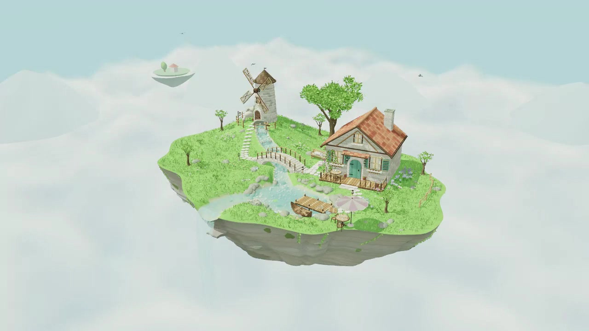

# A Fresh Little World

A self-created procedural 3D interaction demo: a quiet floating island with a cottage, windmill, tree garden, stream, stone bridge, lake and waterfall. The scene is built with TypeScript and Three.js, with custom geometry, water shaders and synthesized ambience.

[Open the interactive demo](https://wjia6881-eng.github.io/a-fresh-little-world/)

## Explore

- Drag with the left mouse button to orbit, scroll to zoom, and drag with the right button to pan.
- Use the six scene buttons for smooth camera transitions. Manual dragging interrupts a transition.
- Click the cottage door, windmill, tree, cat, lake or boat to trigger a small response.
- Toggle automatic orbit and ambient sound, or choose High, Standard or Performance quality. Sound starts only after you enable it.
- Press H to hide or show the interface, Esc to show it, and R to return to the overview. Double-click the canvas to restore a hidden interface.

The scene includes moving foliage, sheep, butterflies, birds and water. A browser with WebGL2 support is required. Desktop mouse interaction is the verified interaction path; performance depends on your hardware and browser.

## Static hosting

This repository contains the public static build and its poster. It needs an HTTP or HTTPS static host and no application server or external asset service. Asset links are relative so the build works under a site subdirectory. Serve this directory with any static HTTP server; opening index.html directly through file:// is not supported.

## Credits

Three.js and its addons are used under their MIT License. See [THIRD_PARTY_NOTICES.md](THIRD_PARTY_NOTICES.md) and [the library license](licenses/three-LICENSE.txt). These notices cover the third-party library, not the original project as a whole.

## Contact

[View my Upwork profile](https://www.upwork.com/freelancers/~0143439f6a710d7829)

